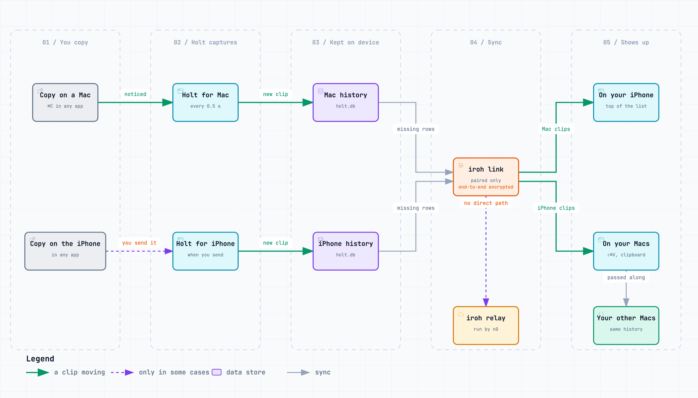
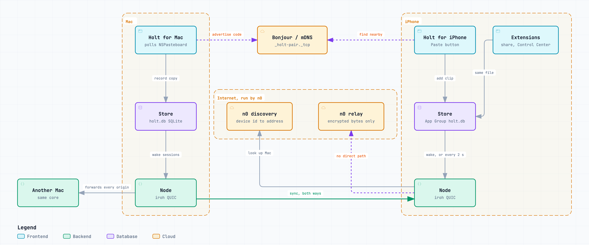

# Contributing to Holt

Thanks for helping. Bug reports, ideas and pull requests are all welcome.

## Setup

You need Xcode and Rust (`curl https://sh.rustup.rs -sSf | sh`).

```sh
git clone https://github.com/snowztech/holt
cd holt
make run
```

`make run` builds the Rust core, generates its Swift bindings, builds `build/Holt.app`, signs it and opens it. The first build takes a few minutes while Cargo compiles dependencies. After that it's seconds.

The Makefile signs with your Apple Development certificate if you have one. That matters: macOS ties permissions like Accessibility to the signature, and with ad-hoc signing it forgets them on every rebuild.

## How it fits together

How a clip travels from a copy on one device to your others:



And the pieces in each app that make it happen:



Both diagrams come from [Archify](https://github.com/tt-a1i/archify) specs, `docs/flow.json` and `docs/architecture.json`. Edit the spec, then export a new PNG.

```
core/holt-core/        Rust
  src/lib.rs           Store: SQLite history, search, and the sync merge rules
  src/net.rs           Node: pairing and sync between devices, over iroh
apple/                 Swift package for the Mac app
  Sources/HoltCore/    Generated Swift bindings (from `make core`, not committed)
  Sources/Holt/        The app
raycast/               Raycast extension. Reads the history database read-only
```

The core is plain Rust with [UniFFI](https://mozilla.github.io/uniffi-rs/) annotations. `make core` builds it as a static library, generates `holt_core.swift`, and packages both as `apple/HoltCoreFFI.xcframework`. The Swift app only talks to `Store` and `Node`.

In the app:

| File | What's in it |
| --- | --- |
| `App.swift` | Launch, menu bar menu, pasting |
| `Popup.swift` | The ⇧⌘V panel |
| `Settings.swift` | Settings window, shortcut recorder |
| `Devices.swift` | Pairing UI |
| `Welcome.swift` | First-launch checklist |
| `Toast.swift` | The notice when a clip arrives from another Mac |
| `Clipboard.swift` | Clipboard watcher, global shortcut, paste keystroke |
| `Brand.swift` | Colors, the otter mark, Skip, the app icon |
| `Prefs.swift` | Settings storage and permission checks |
| `Updates.swift` | Sparkle auto-updates. Only builds from `make dist` have the update feed, so `make run` builds never update themselves |

## Working on the UI

Open a window straight away instead of clicking through the menu:

```sh
make mac && open build/Holt.app --args -HoltOpen settings   # or devices, welcome
```

To see the first-launch window again: `defaults delete app.holtclip.Holt onboarded`.

You can also open `apple/Package.swift` in Xcode after running `make core` once. Running from Xcode skips the app bundle, so menu bar and permission behavior differ. Use it for SwiftUI previews and debugging, and `make run` to check the real thing.

Logs go to the unified log: in Console.app, filter by `subsystem:app.holtclip.Holt`.

## Working on the iPhone app

```sh
make ios                       # builds the core for iPhone and the app for the Simulator
open apple/ios/Holt.xcodeproj  # to run it on your phone, signed with your team
```

`apple/ios/project.yml` is the source of truth. XcodeGen generates the Xcode project, `Info.plist` and entitlements from it, so none of those are committed.

The app shares `HoltBrand` (Skip and the colors) with the Mac app. Its share sheet and Control Center button are app extensions, so the history lives in the App Group `group.app.holtclip.Holt` that all three open.

For a stand-in Mac, run `cd core && cargo run --release --example peer`. Launch arguments help with testing:

- `-HoltPairLink "holt://pair?id=…&code=…"` pairs as if the Camera opened the Mac's QR code
- `-HoltOpen pair`, `settings` or `sendfaster` opens that screen

For App Store screenshots, the peer can pose as a Mac with demo clips: `HOLT_PEER_NAME` names it, `HOLT_PEER_CLIPS` is a file of clips separated by `---` lines (`#pin` on a clip's first line pins it), and `HOLT_PEER_GAP` spaces them out in seconds. The screenshots live in `apple/ios/AppStore/screenshots/`.

`make testflight` archives the app and uploads it to TestFlight. It reads an App Store Connect API key from `ASC_KEY_PATH`, `ASC_KEY_ID` and `ASC_ISSUER_ID`, so nothing secret is in the repo.

`docs/ios-spike.md` has what we measured and what's still to test on a real iPhone.

## Tests and checks

```sh
make test   # Rust tests, including two nodes pairing and syncing over localhost
make lint   # cargo fmt, clippy, swift format
make fmt    # fix formatting
```

`cd core && cargo test -- --ignored real_network` pairs and syncs two nodes over your real network (mDNS and iroh's relays). Run it when you touch `net.rs`.

CI runs lint, tests and a full app build on every pull request.

## Pull requests

- Keep them small and about one thing.
- Commit messages follow [Conventional Commits](https://www.conventionalcommits.org): `feat(mac): ...`, `fix(core): ...`.
- Add a test for logic changes in the core. UI changes need a screenshot in the PR.
- Changes to the sync protocol need care: old and new versions must keep talking to each other. New fields on `Row` get `#[serde(default)]`.

## Design notes

- Holt should feel like part of macOS: system font, native controls, river teal as the one accent color.
- Skip the otter is the identity, and it's one drawing. `SkipFace` in `Brand.swift` holds the face's shapes, and everything draws from it:
  - the full Skip, holding a pebble: app icon, welcome window, empty states, About
  - Skip's face in color, the logo: search field, arrival notice, the site, the favicon
  - Skip's face in one color: the menu bar, where macOS wants a template icon
- Change Skip in `SkipFace` and in the site's `#skip-face` SVG together, then run `make icon`.
- Write copy for people, not engineers: "Paste for you", not "Accessibility permission".
