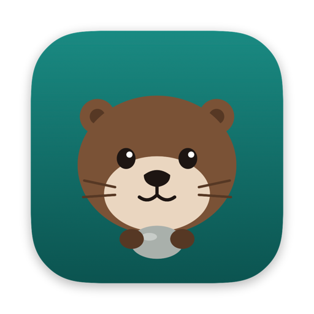
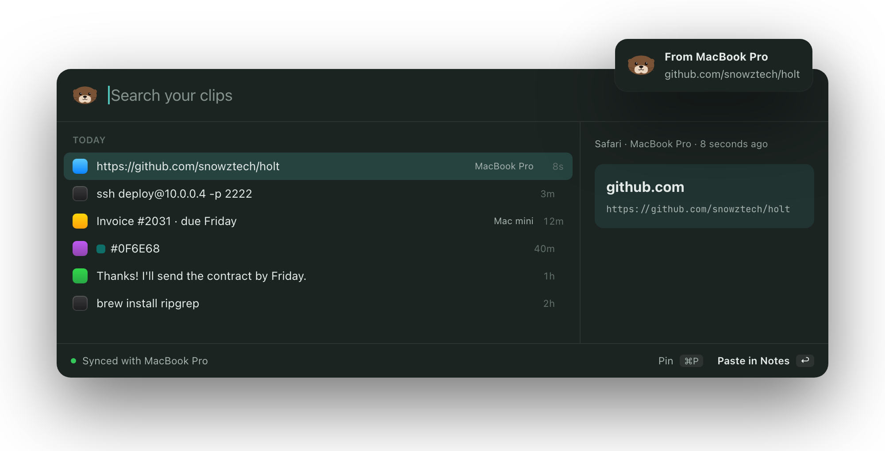

<p align="center">
  
</p>

<h1 align="center">Holt</h1>

<p align="center">
  <strong>Your clipboard, kept.</strong><br>
  Clipboard history for macOS, synced between your Macs. Free and open source.<br>
  <a href="https://holt.snowztech.com">holt.snowztech.com</a>
</p>

<p align="center">
  <a href="https://github.com/snowztech/holt/actions/workflows/ci.yml"></a>
  <a href="https://github.com/snowztech/holt/releases/latest"></a>
  <a href="LICENSE"></a>
  
</p>

<p align="center">
  <picture>
    <source media="(prefers-color-scheme: light)" srcset="site/assets/readme-popup-light.png">
    
  </picture>
</p>

## What it does

- **Find anything you copied.** Press ⇧⌘V and start typing. Every word has to match, so `ssh 10.0` finds that one command from last week.
- **Paste where you were.** Pick a clip and press return. Holt pastes it into the app you were typing in.
- **Pin what you reuse.** Pinned clips stay at the top and never expire.
- **On every Mac.** Pair your Macs once. Copy on one, press ⌘V on the other a second later.
- **Private.** No account and no Holt server. Copies that password managers mark as private are never recorded.

## Compared to

| | Holt | Universal Clipboard | Maccy | Paste |
| --- | --- | --- | --- | --- |
| History and search | Yes | No | Yes | Yes |
| Sync between Macs | Yes, over any network | Last copy only, devices nearby | No | Yes, through iCloud |
| iPhone | Coming | Yes | No | Yes |
| Open source | Yes | No | Yes | No |
| Price | Free | Free | Free | Subscription |

## Install

[Download Holt](https://github.com/snowztech/holt/releases/latest/download/Holt.dmg), open the disk image and drag Holt to Applications. Or with Homebrew:

```sh
brew install --cask snowztech/tap/holt
```

It needs macOS 14 or later on Apple Silicon. Releases are signed and notarized, so macOS opens Holt without warnings.

To build from source instead, you need Xcode and Rust ([rustup.rs](https://rustup.rs)):

```sh
git clone https://github.com/snowztech/holt
cd holt
make run
```

On first launch, a short checklist walks you through setup:

- **See what you copy.** Required. Set Holt to Always Allow in System Settings → Privacy & Security → Paste from Other Apps. Without it, macOS asks on every copy.
- **Paste for you.** Optional. Accessibility access lets Holt paste into the app you're in. Without it, Holt copies the clip and you press ⌘V.
- **Open at login.** Recommended, so Holt never misses a copy after a restart.

## Keyboard shortcuts

| Key | What it does |
| --- | --- |
| ⇧⌘V | Open Holt. Change it in Settings → General. |
| ↑ ↓ | Move through clips |
| ↩ | Paste the clip |
| ⌘1 to ⌘9 | Paste one of the first nine. Hold ⌘ to see the numbers. |
| ⌘P | Pin or unpin |
| ⌘O | Open a link |
| ⌘⌫ | Delete, here and on your other Macs |
| esc | Close |

## Sync between Macs

Open **Settings → Devices** in Holt on both Macs. Each one shows a 6-digit code and lists the other under Nearby. On one Mac, pick the other and type the code it shows.

After that the Macs stay connected, and Holt never uses Bluetooth:

- **Same Wi-Fi.** They talk directly over your local network.
- **Different networks.** They connect directly over the internet.
- **A router in the way.** A relay passes the data along. Sync is end-to-end encrypted, so the relay only sees bytes it can't read.

Copies, pins and deletes all sync. A clip copied on another Mac in the last 2 minutes goes straight onto this Mac's clipboard, and a small notice says where it came from.

Under the hood, the connection is [iroh](https://iroh.computer). The pairing code is checked with SPAKE2, so someone on the same network gets one guess per try, and pairing stops after 5 wrong codes.

## Privacy

- Your history stays on your Macs, in `~/Library/Application Support/Holt/holt.db`. There's no Holt account and no analytics.
- Copies that password managers mark as private are never recorded. In Settings → History you can add apps whose copies Holt ignores.
- Sync is end-to-end encrypted, and only Macs you paired can connect.
- To find each other across networks, your Macs use iroh's public discovery and relay servers. Those see your Macs' network addresses, never your clips.

## Troubleshooting

**Holt doesn't record what I copy.** Set Holt to Always Allow in System Settings → Privacy & Security → Paste from Other Apps. While it's missing, the menu bar menu shows Allow Clipboard Access.

**Picking a clip copies it but doesn't paste.** Turn on Holt in System Settings → Privacy & Security → Accessibility. Holt Settings → General shows whether it's on.

**My other Mac doesn't show up under Nearby.** Both Macs need Holt Settings → Devices open and the same network. Also check that Holt is allowed in System Settings → Privacy & Security → Local Network.

**The code didn't match.** Type the code shown on the other Mac, not this one. After 5 wrong codes that code stops working: close Settings on the other Mac and open Devices again for a new one.

**Uninstall.** `brew uninstall --zap --cask holt`. Without Homebrew, quit Holt, drag it to the Trash and delete `~/Library/Application Support/Holt`.

## Meet Skip

A holt is an otter's den, where it keeps what matters. Sea otters even carry a favorite stone tucked under their arm, everywhere they go.

Skip does the same with what you copy: keeps it safe, and skips it across to your other Mac. Skip's face is the icon in your menu bar.

## Roadmap

- [x] Clipboard history on the Mac
- [x] Sync between Macs
- [x] Signed download and Homebrew
- [ ] iPhone app
- [ ] Images, and search for the text inside screenshots
- [ ] Windows and Linux

## Contributing

Bug reports, ideas and pull requests are welcome. [CONTRIBUTING.md](CONTRIBUTING.md) explains how the code fits together, how to work on the UI, and the checks CI runs.

## License

MIT. Made by [snowztech](https://github.com/snowztech).
